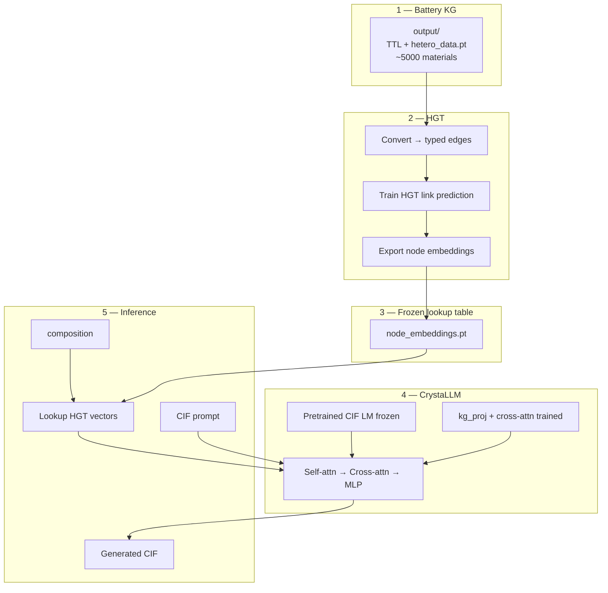
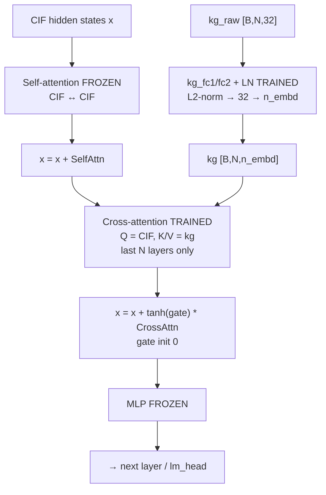
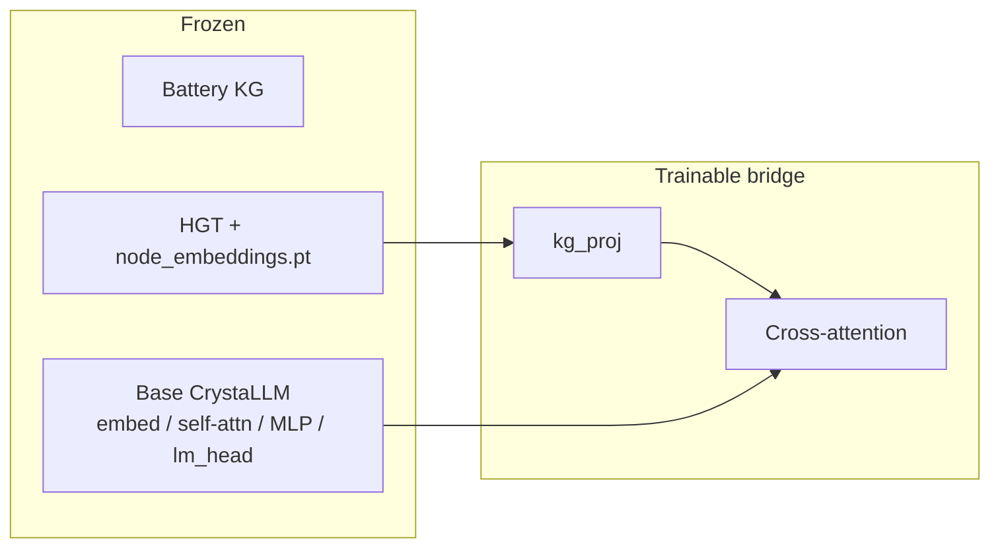
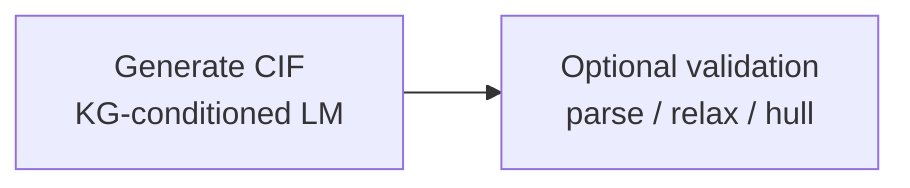

# Battery KG × HGT × CrystaLLM — Technical Pipeline Document

**Project:** Final Year Project — battery knowledge-graph guided crystal structure generation  
**Updated:** 31 August 2026  

Full technical description of the pipeline: battery knowledge graph → HGT node embeddings → CrystaLLM CIF generation conditioned by cross-attention.

---

## Contents

1. [Goal and design constraint](#1-goal-and-design-constraint)
2. [End-to-end pipeline](#2-end-to-end-pipeline)
3. [Battery knowledge graph](#3-battery-knowledge-graph)
4. [HGT training and export](#4-hgt-training-and-export)
5. [Knowledge passed to CrystaLLM](#5-knowledge-passed-to-crystallm)
6. [Cross-attention architecture](#6-cross-attention-architecture)
7. [Frozen vs trainable components](#7-frozen-vs-trainable-components)
8. [Why cross-attention training is required](#8-why-cross-attention-training-is-required)
9. [What the pipeline infers](#9-what-the-pipeline-infers)
10. [How the integration was coded](#10-how-the-integration-was-coded)
11. [Bridge fine-tuning](#11-bridge-fine-tuning)
12. [Commands](#12-commands)
13. [With KG vs without KG](#13-with-kg-vs-without-kg)
14. [Repository layout](#14-repository-layout)
15. [Evaluation and quality](#15-evaluation-and-quality)
16. [FAQ](#16-faq)
17. [Inference run walkthrough (`sample_with_kg.py`)](#17-inference-run-walkthrough-sample_with_kgpy)

---

## 1. Goal and design constraint

**Goal:** generate crystal structures (CIF) for a given composition, conditioned on knowledge from a battery materials knowledge graph.

| Component | Role |
|-----------|------|
| Battery KG | Structured domain knowledge (materials, elements, roles, properties, crystallography) |
| HGT | Learns a fixed-dimensional vector per graph node via heterogeneous link prediction |
| CrystaLLM | Autoregressive language model over CIF tokens |
| Cross-attention bridge | Conditions CIF generation on HGT vectors |

**Design constraint:** CrystaLLM uses a closed CIF tokenizer. Free-text KG facts cannot be injected into the prompt (they become invalid tokens). KG knowledge must enter as **continuous vectors** via **cross-attention**, not as text.

---

## 2. End-to-end pipeline



| Step | Action |
|------|--------|
| 1 | Use battery KG in `output/` |
| 2 | Convert graph → train HGT → export vectors |
| 3 | Freeze export; CrystaLLM only reads the lookup table |
| 4 | Keep pretrained CrystaLLM; add `kg_proj` + cross-attention |
| 5 | Fine-tune bridge on CIF + `kg_context` pairs |
| 6 | Generate: composition → vectors; prompt → CIF tokens |

---

## 3. Battery knowledge graph

**Location:** `output/` (dataset v2.3.2)

| Content | Scale / notes |
|---------|----------------|
| Materials | ~5,000 |
| Elements | 83 |
| Battery roles | electrode, electrolyte, separator, … |
| Properties / structure | band gap, formation energy, hull, space group, crystal system, … |
| Atomic sites / bonds | present in full KG; omitted from HGT train graph for speed |

| Artifact | Role |
|----------|------|
| `battery_kg.ttl` / `.rdf` | RDF source of truth |
| `hetero_data.pt` | Same graph as PyG `HeteroData` — preferred HGT input |

`hetero_data.pt` is the **input graph**, not trained embeddings. CrystaLLM never reads it. After HGT training, CrystaLLM reads **exported** `node_embeddings.pt`.

**HGT train graph** (`data/BatteryKG_v2/`): ~51k nodes, ~68k edges at material level  
material ↔ crystal ↔ space group ↔ role ↔ element ↔ property.

---

## 4. HGT training and export

**Location:** `HGT-Pipeline/battery_hgt/`

### Method

Heterogeneous Graph Transformer (HGT) for typed link prediction:

- Per-node-type embeddings and HGTConv layers
- DistMult-style scoring of `(head, relation, tail)`
- Objective: recover held-out edges (MRR / Hits@K on validation)

### Commands

```bash
cd HGT-Pipeline/battery_hgt

python convert_hetero_to_hgt.py \
  --output-dir ../../output \
  --out-dir data/BatteryKG_v2

python train.py \
  --data-dir data/BatteryKG_v2 \
  --model-dir models/battery_v2 \
  --output-dir outputs/battery_v2 \
  --embedding-dim 32 --num-heads 2 --num-layers 1 \
  --epochs 30 --batch-size 1024

python export_embeddings.py \
  --model-dir models/battery_v2 \
  --data-dir data/BatteryKG_v2 \
  --out-dir models/battery_v2/export_package
```

### Outputs

| File | Role |
|------|------|
| `hgt_checkpoint.pt` | Trained HGT weights |
| `hgt_mappings.pt` | Node / relation vocabulary |
| `export_package/node_embeddings.pt` | Vectors consumed by CrystaLLM |
| `export_package/id_maps.json` | Name → `(node_type, local_idx)` |
| `export_package/meta.json` | Embedding dim and paths |

**Status:** `battery_v2`, embedding dim 32, best val MRR ≈ 0.11. After export, HGT is frozen. Inference does not run HGT live; it indexes rows in `node_embeddings.pt`.

---

## 5. Knowledge passed to CrystaLLM

At fine-tune and generate time, a composition is mapped to a small set of HGT vectors.

### Lookup procedure (`kg_context.py`)

1. Parse formula → element symbols (`LiFePO4` → Li, Fe, P, O).
2. If a material node matches the formula, include its vector.
3. Resolve names through `id_maps.json`.
4. Load rows from `node_embeddings.pt`.
5. Stack ≤ `top_k` (default 8) vectors → `kg_raw` with shape `[1, N, 32]`.

| Composition | KG context |
|-------------|------------|
| In KG (e.g. LiFePO4) | material + element vectors |
| Not in KG as material (e.g. Li3Mn2NiO6) | element vectors only |

### Semantics of a vector

Each vector is a **learned encoding of the node’s graph neighbourhood** (roles, structure links, property links, co-occurring chemistry). It is not a human-readable property string and is never written into the CIF as text. After bridge training, cross-attention uses it as a soft prior over next CIF tokens.

---

## 6. Cross-attention architecture

### Why this interface

| Alternative | Failure mode |
|-------------|--------------|
| Paste KG text into the CIF prompt | Closed CIF vocab → invalid tokens |
| Replace CrystaLLM with HGT | HGT does not emit CIF |
| **Cross-attention** | CIF stays in token space; KG stays in vector space |

### Runtime inputs

| Input | Example | Path |
|-------|---------|------|
| CIF prompt | `FILE:prompt_lino2.txt` or `data_LiFePO4\n` | Self-attention |
| Composition | `composition=LiFePO4` | Lookup → cross-attention |

### Block structure

Early layers stay vanilla GPT (CIF syntax). Only the **last `kg_n_layers` (default 2)** blocks add gated KG cross-attention. The tanh gate starts at 0, so step 0 is identical to vanilla CrystaLLM.



| Tensor | Shape | Meaning |
|--------|-------|---------|
| `x` | `[B, T, n_embd]` | CIF token states (`n_embd` = 512 for small model) |
| `kg_raw` | `[B, N, 32]` | HGT vectors |
| `kg` | `[B, N, n_embd]` | Projected KG for K/V |
| Cross-attn output | `[B, T, n_embd]` | Residual into CIF stream |

**Mechanism**

- Multi-head attention: **Q** from CIF, **K/V** from projected KG.
- Non-causal over the N KG vectors (all visible every step).
- Same `kg` reused for the entire generation trajectory.
- If `kg_context` is omitted, behaviour ≈ vanilla CrystaLLM.

**Implementation:** `CrystaLLM/crystallm/_model.py` (`CrossAttention`, `Block`, `kg_proj`); `crystallm/kg_context.py` (composition → `kg_raw`).

---

## 7. Frozen vs trainable components



| Component | Status | Reason |
|-----------|--------|--------|
| Battery KG | Data | Source graph |
| HGT after export | Frozen | Vectors already computed |
| `node_embeddings.pt` | Frozen lookup | Shared at train and test |
| Base CrystaLLM | Frozen | Already pretrained on large CIF corpora (~2M train CIFs in original CrystaLLM) |
| `kg_proj` + cross-attention | **Trainable** | New layers; must learn to use KG vectors |

| Phrase | Meaning |
|--------|---------|
| Do not retrain CrystaLLM from scratch | Base CIF modelling is already available |
| Do not retrain HGT at every generate | Use the export table |
| Fine-tune the bridge | Required so new layers use KG vectors usefully |

---

## 8. Why cross-attention training is required

The pipeline has **three** trained parts that must work together. Only one of them is missing at integration time.

| Part | What it already knows | Train again? |
|------|------------------------|--------------|
| CrystaLLM | CIF syntax, lattices, atom sites (~2M CIF pretrain) | **No** — freeze |
| HGT | Battery graph structure per node (link prediction on KG) | **No** — freeze after export |
| Cross-attn + `kg_proj` | Nothing about KG ↔ CIF | **Yes** — this is the bridge |

### Why not “just connect and run”?

New layers start with **random weights**. Even with perfect HGT vectors for LiFePO4:

- the model does not know which CIF token positions should attend to Li vs Fe vs the material node  
- the projected vectors act as **noise** in hidden states until trained  
- base CrystaLLM was never trained with `kg_context`; its self-attention weights do not interpret HGT space  

Training the bridge shows paired examples:

```text
(CIF token sequence, kg_context for that composition) → predict next CIF token
```

Only `kg_proj` and cross-attention receive gradients. They learn a **translation** from graph-vector space to CIF-generation space.

### Analogy

- CrystaLLM = author who writes CIF  
- HGT export = encyclopedia of battery materials (as vectors)  
- Cross-attention = new sense that must be **calibrated** — connection exists, but behaviour is wrong until fine-tuned  

---

## 9. What the pipeline infers

### Primary output

The pipeline **generates CIF text**: cell parameters (if prompted), atom-type blocks, atom-site loops, fractional coordinates. That is the only direct inference product.

```text
composition + prompt + KG vectors  →  sample_kg_*.cif
```

### What KG knowledge influences (indirectly)

HGT material vectors encode graph neighbours such as:

- battery **role** links (electrode, electrolyte, …)  
- **structure** links (crystal, space group)  
- **property** links in the KG (band gap, formation energy, **energy above hull**, …)  

These are **not** emitted as readable fields. They are mixed into hidden states via cross-attention and can **bias** which CIF tokens are chosen (e.g. atom-site patterns common for cathode-like materials in the training data).

| Question | Honest answer |
|----------|----------------|
| Does it make CIFs “battery-related”? | **Can, after proper bridge fine-tune** — especially when the material is in the KG with role/structure links. Not guaranteed with the current tiny fine-tune. |
| Does it **reduce energy above hull**? | **Not directly.** The model does not optimize hull or run thermodynamics. Hull information may be **implicit** in material vectors (via `hasProperty` → `energy_above_hull` edges in the KG), but generation is still next-token prediction, not energy minimization. |
| How would you know hull improved? | **Post-process:** relax generated CIF (DFT / MLIP) and compute hull vs a baseline — that step is **outside** the current generate script. |



**Summary:** KG cross-attention steers **structure generation** toward patterns associated with battery-graph knowledge. It is **not** a hull optimizer. Claiming lower hull requires measuring it after generation.

### With KG vs without KG — what changes at inference

| | With KG | Without KG |
|--|---------|------------|
| Inputs | CIF prompt + composition → HGT vectors | CIF prompt only |
| Hidden state | Self-attn + cross-attn to KG K/V | Self-attn only |
| Output type | CIF file | CIF file |
| Expected bias | Chemistry / roles encoded in looked-up nodes | Generic CIF LM prior |

---

## 10. How the integration was coded

End-to-end wiring in four layers: **graph → HGT export → CrystaLLM model changes → train/generate scripts**.

### Layer 1 — Battery graph for HGT

| File | Role |
|------|------|
| `HGT-Pipeline/battery_hgt/convert_hetero_to_hgt.py` | Reads `output/hetero_data.pt`, writes typed edge CSVs + `schema.json` under `data/BatteryKG_v2/` |
| `HGT-Pipeline/battery_hgt/parse_battery_kg.py` | Alternative: TTL/RDF → same CSV layout |
| `HGT-Pipeline/battery_hgt/train.py` | HGT link prediction; saves `hgt_checkpoint.pt`, `hgt_mappings.pt` |
| `HGT-Pipeline/battery_hgt/export_embeddings.py` | Runs HGT encoder on graph; writes `export_package/node_embeddings.pt` + `id_maps.json` |

### Layer 2 — Composition → KG tensor

**File:** `CrystaLLM/crystallm/kg_context.py`

- `KGContextBuilder` loads export once.  
- `build(composition)` parses formula, looks up material + elements in `id_maps.json`, stacks rows from `node_embeddings.pt` → `kg_raw [1, N, 32]`.  
- Used identically at **fine-tune** and **generate** (same frozen table).

### Layer 3 — Cross-attention inside GPT

**File:** `CrystaLLM/crystallm/_model.py`

| Change | Purpose |
|--------|---------|
| `GPTConfig.use_kg_cross_attn`, `kg_dim` | Enable KG path |
| `GPT.kg_fc1` / `kg_fc2` / `kg_ln` | L2-normalize HGT rows, then 32 → n_embd with LayerNorm |
| `GPT.kg_type_emb` | material / element / … type embeddings (zero at init) |
| `CrossAttention` | `wq` on CIF states; `wk`/`wv` on projected KG; last N layers only |
| `Block.kg_gate` | Flamingo tanh gate; `tanh(0)=0` so the residual is off at init |
| `Block.forward(x, kg)` | Self-attn → gated cross-attn (if this layer has it and `kg` is set) → MLP |
| `GPT.forward(..., kg_context)` | Projects `kg_context`; skips cross-attn entirely when `kg_context` is None |
| `GPT.generate(..., kg_context)` | Reuses same `kg_context` each new token |

Forward path:

```text
idx → token + position embed → for each Block:
        x += SelfAttn(LN(x))
        if last-N layer and kg is not None:
            x += tanh(gate) * CrossAttn(LN(x), kg)
        x += MLP(LN(x))
→ lm_head → next CIF token logits
```

### Layer 4 — Training and inference scripts

| File | Role |
|------|------|
| `bin/finetune_with_kg.py` | Load `crystallm_v1_small`; set `use_kg_cross_attn=True`; freeze all params except `cross_attn`, `kg_proj`, `kg_null`, block `ln_x`; loop over CIF folder with `KGContextBuilder.build(composition)`; save `out_kg_finetune/ckpt.pt` |
| `bin/sample_with_kg.py` | Load fine-tuned ckpt; `build_kg_context(hgt_export, composition)`; call `model.generate(..., kg_context=kg_raw)` |
| `bin/sample.py` | Baseline — no `kg_context` |

### Integration constraint that drove the design

CrystaLLM’s CIF tokenizer cannot represent free-text KG triples. The integration **bypasses the tokenizer** for KG: vectors enter **after** embedding, in cross-attention, parallel to the CIF token stream.

---

## 11. Bridge fine-tuning

### Objective

Train only the bridge so CIF next-token prediction is conditioned on `kg_context`.

| Train | Freeze |
|-------|--------|
| `kg_proj` | Base CrystaLLM |
| Cross-attention (all blocks) | HGT / export |

Trainable parameter count ≈ 8.4M in the current small setup.

### Training example

- Input / target: CIF token sequence (standard LM loss)
- Side input: `kg_raw` for that CIF’s composition (from frozen export)

### Data roles

| Data | Scale | Role |
|------|-------|------|
| Battery KG materials | ~5,000 | HGT → vectors (done) |
| CrystaLLM pretraining CIFs | ~2M (in checkpoint) | Frozen base LM (done) |
| CIFs for bridge fine-tune | hundreds–thousands needed | Teach KG conditioning |

Graph nodes are not CIF files. Bridge fine-tuning requires CIF text whose composition can be resolved in the export.

### Procedure

1. Assemble a CIF corpus (battery-relevant preferred; MP / CrystaLLM subsets acceptable).
2. Keep `crystallm_v1_small` and `battery_v2/export_package` frozen.
3. Run `bin/finetune_with_kg.py`.
4. Save checkpoint under `out_kg_finetune/`.
5. Evaluate with A/B generation (Section 10).

### Command

```bash
cd CrystaLLM
python bin/finetune_with_kg.py \
  out_dir=crystallm_v1_small \
  hgt_export=../HGT-Pipeline/battery_hgt/models/battery_v2/export_package \
  cif_dir=kg_finetune_cifs \
  fresh_kg=true \
  max_cifs=0 \
  max_iters=12000 \
  kg_n_layers=2 \
  learning_rate=1e-4 \
  device=mps \
  save_dir=out_kg_finetune
```

Retrain from vanilla (`fresh_kg=true`). The old all-layer / ungated checkpoint is not compatible with this bridge.

| Scale | Approx. wall time (Apple MPS, batch 1) |
|-------|----------------------------------------|
| 300 iters (smoke test) | ~1 min |
| 3,000 iters | ~10–15 min |
| 10,000 iters | ~30–60 min |

### Retrain matrix

| Change | Action | Full CrystaLLM retrain? |
|--------|--------|-------------------------|
| KG content changes | Retrain HGT → re-export → re-fine-tune bridge | No |
| Need better conditioned CIFs | More bridge CIF data / steps | No |
| HGT embedding dimension changes | Re-export → re-fine-tune bridge | No |

---

## 12. Commands

Project Python: `.venv/bin/python` from the repo root (or activate the venv).

### Generate with KG

```bash
cd CrystaLLM
python bin/sample_with_kg.py \
  out_dir=out_kg_finetune \
  composition=Li3Mn2NiO6 \
  start=FILE:prompt_lino2.txt \
  hgt_export=../HGT-Pipeline/battery_hgt/models/battery_v2/export_package \
  num_samples=10 \
  max_new_tokens=400 \
  device=mps \
  target=file
```

| Log field | Meaning |
|-----------|---------|
| `KG matches (…)`) | Nodes selected from the export |
| `kg_raw shape` | Tensor fed to cross-attention |
| `missing keys: 0` | Bridge weights present in checkpoint |
| `wrote sample_kg_*.cif` | Outputs written |

- `composition` → KG lookup  
- `start` → CIF prompt (self-attention)  
- Outputs: `sample_kg_1.cif`, …

### Generate without KG (baseline)

```bash
cd CrystaLLM
python bin/sample.py \
  out_dir=crystallm_v1_small \
  start=FILE:prompt_lino2.txt \
  num_samples=1 \
  max_new_tokens=400 \
  seed=1337 \
  device=mps \
  target=file
```

### Controlled A/B comparison

Hold fixed: `start`, `seed`, `temperature`, `top_k`, `max_new_tokens`.

```bash
# With KG
python bin/sample_with_kg.py \
  out_dir=out_kg_finetune \
  composition=Li3Mn2NiO6 \
  start=FILE:prompt_lino2.txt \
  hgt_export=../HGT-Pipeline/battery_hgt/models/battery_v2/export_package \
  num_samples=1 max_new_tokens=400 seed=1337 \
  device=mps target=file

# Without KG
python bin/sample.py \
  out_dir=crystallm_v1_small \
  start=FILE:prompt_lino2.txt \
  num_samples=1 max_new_tokens=400 seed=1337 \
  device=mps target=file
```

### Rebuild HGT (only when the KG changes)

```bash
cd HGT-Pipeline/battery_hgt
python convert_hetero_to_hgt.py --output-dir ../../output --out-dir data/BatteryKG_v2
python train.py --data-dir data/BatteryKG_v2 --model-dir models/battery_v2 \
  --output-dir outputs/battery_v2 --embedding-dim 32 --num-heads 2 \
  --num-layers 1 --epochs 30 --batch-size 1024
python export_embeddings.py --model-dir models/battery_v2 --data-dir data/BatteryKG_v2 \
  --out-dir models/battery_v2/export_package
```

---

## 13. With KG vs without KG

| | With KG | Without KG |
|--|---------|------------|
| Entry point | `bin/sample_with_kg.py` | `bin/sample.py` |
| Checkpoint | `out_kg_finetune` | `crystallm_v1_small` |
| Conditioning | composition → HGT vectors → cross-attn | CIF prompt only |
| Knowledge | Battery graph neighbourhood | CIF language prior only |

**Expected advantage of KG (after adequate bridge fine-tune)**

- Better use of compositions covered by the battery KG  
- Structures more consistent with graph-encoded chemistry / roles  
- Measurable gains on parseability, stoichiometry match, clash rate, optional post-relax metrics  

**Current status**

| Check | Result |
|-------|--------|
| End-to-end KG path | Operational (lookup + generate) |
| Both paths emit CIF-like continuations | Yes |
| Demonstrated quality superiority of KG | Not yet — bridge fine-tune still at smoke-test scale |

Pipeline integration is complete. A statistically meaningful KG win requires larger bridge fine-tune data, then the A/B protocol above.

---

## 14. Repository layout

```text
FinalYearProj/
  output/                              # battery KG
    battery_kg.ttl
    hetero_data.pt

  HGT-Pipeline/battery_hgt/
    convert_hetero_to_hgt.py
    parse_battery_kg.py                # TTL → edges (alternative)
    train.py / test.py / predict.py
    export_embeddings.py
    models/hgt.py
    data/BatteryKG_v2/
    models/battery_v2/
      hgt_checkpoint.pt
      hgt_mappings.pt
      export_package/
        node_embeddings.pt
        id_maps.json
        meta.json

  CrystaLLM/
    crystallm_v1_small/                # frozen pretrained CIF LM
    out_kg_finetune/                   # bridge fine-tune checkpoint
    crystallm/_model.py                # CrossAttention, kg_proj
    crystallm/kg_context.py            # composition → kg_raw
    bin/finetune_with_kg.py
    bin/sample_with_kg.py
    bin/sample.py
```

| Module | Responsibility |
|--------|----------------|
| `convert_hetero_to_hgt.py` | Graph → HGT edge CSVs |
| `train.py` | HGT link prediction |
| `export_embeddings.py` | Checkpoint → node vectors |
| `_model.py` | Cross-attention integration |
| `kg_context.py` | Composition → KG tensor |
| `finetune_with_kg.py` | Bridge-only training |
| `sample_with_kg.py` | KG-conditioned generation |

---

## 15. Evaluation and quality

| Setup | Expectation |
|-------|-------------|
| Smoke-test bridge fine-tune | Pipeline correctness; structures often imperfect |
| Bridge fine-tune on hundreds–thousands of CIFs | Fair with/without KG comparison |
| Strong result | Large CIF set, more steps; high KG coverage of evaluation compositions |

**Suggested metrics**

- CIF parse success  
- Element / stoichiometry agreement with target formula  
- Minimum interatomic distance / clash heuristics  
- Optional: energy after structure relaxation  

Compositions present as material nodes receive material + element vectors. Missing materials fall back to element-only context until added to the KG.

---

## 16. FAQ

| Question | Answer |
|----------|--------|
| Is the KG CIF data? | No — a materials knowledge graph |
| What does CrystaLLM read from the KG path? | Frozen HGT vectors in `node_embeddings.pt` |
| How are nodes selected? | Parse composition → name match → load rows |
| What do the vectors do during generation? | Cross-attention K/V; bias next CIF tokens |
| Retrain full CrystaLLM? | No |
| Fine-tune entire GPT? | No — only `kg_proj` + cross-attention |
| Is the pretrained CIF LM sufficient as a base? | Yes — keep it frozen |
| Is that enough for the KG bridge? | No — bridge still needs CIF + `kg_context` fine-tuning at scale |
| Inference without `kg_context`? | ≈ original CrystaLLM |
| Does KG reduce energy above hull automatically? | **No** — hull may be implicit in vectors; measure after relax if needed |
| Does KG make outputs battery-related? | **Indirectly** — via role/structure/property neighbourhood in vectors + bridge training |
| Path to higher quality? | Larger bridge fine-tune; better KG coverage of target materials; optional post-relax hull checks |

---

## 17. Inference run walkthrough (`sample_with_kg.py`)

This section explains a real generate command (LiFePO4, 10 samples) and every log line, including **missing keys**. Architecture detail is in [§6](#6-cross-attention-architecture) and [§10](#10-how-the-integration-was-coded).

### Command

```bash
cd CrystaLLM
.venv/bin/python bin/sample_with_kg.py \
  out_dir=out_kg_finetune \
  composition=LiFePO4 \
  hgt_export=../HGT-Pipeline/battery_hgt/models/battery_v2/export_package \
  num_samples=10 \
  max_new_tokens=400 \
  target=file \
  device=cpu
```

Uses **two** artifacts:

| Artifact | Role |
|----------|------|
| `out_kg_finetune/ckpt.pt` | Fine-tuned CrystaLLM (base GPT + trained KG bridge) |
| `export_package/node_embeddings.pt` + `id_maps.json` | Frozen HGT lookup table |

HGT is **not** trained or run at generate time.

### What happens, in order

```text
1. Read composition=LiFePO4
2. Load id_maps.json + node_embeddings.pt
3. Parse formula → Li, Fe, P, O
4. Lookup names → (node_type, local_idx)
5. Copy embedding rows → kg_raw [1, 5, 32]
6. Load out_kg_finetune/ckpt.pt
7. Prompt = "data_LiFePO4\n"  (CIF tokens)
8. For each of 10 samples:
      generate next CIF tokens
      every step: self-attn on CIF + cross-attn to kg_raw
9. Write sample_kg_1.cif … sample_kg_10.cif
```

### Log line by line

| Log | Meaning |
|-----|---------|
| `Composition: LiFePO4` | String used for **KG lookup** (not SPARQL, not TTL) |
| `KG matches (5): material:LiFePO4, element:Li, Fe, P, O` | Five nodes found in `id_maps.json` |
| `kg_raw shape: (1, 5, 32)` | Batch 1, 5 vectors, HGT dim 32 — this is `kg_context` |
| `Loaded … out_kg_finetune/ckpt.pt` | Fine-tuned checkpoint, not `crystallm_v1_small` |
| `missing keys (new KG layers): 0` | Bridge weights **are in** the checkpoint (see below) |
| `unexpected keys: 0` | Checkpoint has no leftover unused tensors |
| `Prompt: 'data_LiFePO4\n'` | CIF **text** start; file prompt would be `start=FILE:…` |
| `wrote sample_kg_*.cif` | Ten independent samples (same `kg_raw`, different token draws) |

Fetch code: `crystallm/kg_context.py` (`_lookup` → `node_embeddings[ntype][local_idx]`).  
Generate code: `bin/sample_with_kg.py` → `model.generate(..., kg_context=kg_raw)`.  
Cross-attn code: `crystallm/_model.py` (`kg_proj`, `CrossAttention`: Q = CIF, K/V = KG).

### What “missing keys” means

PyTorch `load_state_dict(..., strict=False)` compares:

- tensors **in the model** (including new KG layers)
- tensors **in the checkpoint file**

**Missing keys** = the **model has a weight** that the **checkpoint does not**.

| `missing keys` | Checkpoint | What it means |
|----------------|------------|----------------|
| **0** | `out_kg_finetune/ckpt.pt` | Fine-tune saved `kg_proj` + every `cross_attn.*` + `ln_x`. **This run.** |
| **> 0** | `crystallm_v1_small/ckpt.pt` used with `sample_with_kg.py` | Vanilla CrystaLLM has no KG layers. Script still builds them, then they stay **random**. Log says `(expected until you run finetune_with_kg.py)`. |

So **0 is the good value** for a KG-fine-tuned model. It does **not** mean “knowledge was missing from the KG.”

Typical missing names if you load the small model into a KG-enabled GPT:

```text
kg_proj.weight, kg_proj.bias, kg_null
transformer.h.{0..n}.cross_attn.wq/wk/wv/c_proj.*
transformer.h.{0..n}.ln_x.*
```

Those exist only after `finetune_with_kg.py`.

### How fetch works (no live KG)

```text
"LiFePO4"
    → parse_elements → ["Li","Fe","P","O"]
    → name_to_nodes["LiFePO4"] → {node_type: material, local_idx: i}
    → name_to_nodes["Fe"]      → {node_type: element,  local_idx: j}
    → node_embeddings["material"][i]   # 32 floats
    → node_embeddings["element"][j]
    → stack → kg_raw
```

If the formula is not a material name in `id_maps` (e.g. some `Li3Mn2NiO6` runs), matches are **element-only**.

### How cross-attention uses `kg_raw`

Every transformer block, every new token:

```text
CIF hidden x  --self-attn-->  (tokens look at other tokens)
              --cross-attn--> Q = x,  K/V = kg_proj(kg_raw)
              --MLP-->
→ lm_head → next CIF token
```

The same five vectors are reused for all 400 tokens and all 10 files. Sampling (`temperature`, `top_k`) makes the ten files differ.

### Quality of the ten CIFs

The **pipeline is correct**. The **structures are often not valid LiFePO4** (e.g. missing Fe, wrong formula) because the **bridge was fine-tuned on very few CIFs**. See [§13](#13-with-kg-vs-without-kg) and [§15](#15-evaluation-and-quality).

For stronger CIF quality without claiming a KG win, generate with `bin/sample.py` and `out_dir=crystallm_v1_small`. For a KG-conditioned demo with a trained bridge, keep `out_kg_finetune` as in this walkthrough.
